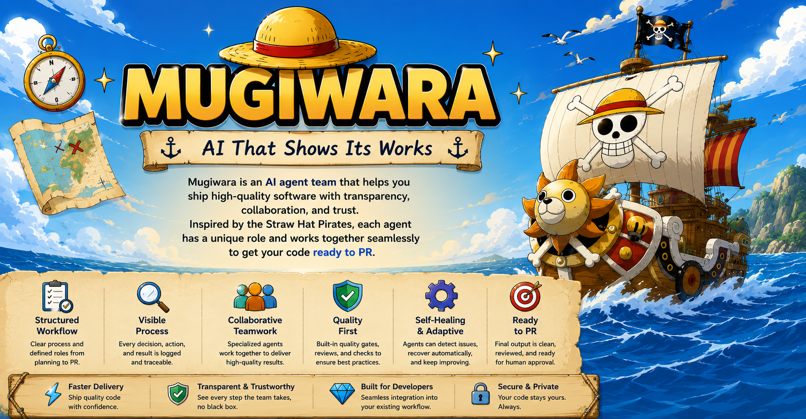

# Mugiwara

[](https://www.npmjs.com/package/@ionivetech/mugiwara)
[](https://www.npmjs.com/package/@ionivetech/mugiwara)
[](https://github.com/ionivetech/mugiwara/blob/main/LICENSE)

**A review discipline for AI coding agents. For risky changes, it plans first, checks its own work, and leaves one report a human can review.**

An agent can write 400 lines in five minutes, say "tests pass", and leave nothing you can open or attach to a PR. Mugiwara gives the agent a crew of named roles, a process that grows with the risk of the change, and a closing report. It is markdown your agent already reads: no runtime, no server, no API keys of its own.



## What it looks like

You ask for something risky. The crew sizes the work, says what it will do, and stops to ask what it cannot guess. A real first reply (shortened) to `/mugiwara add role-based access control: admin, editor, viewer` in a small repo:

```text
Crew: Luffy triages, Usopp clarifies, Nami plans, Zoro builds, Robin and Jinbe review, Sanji and Franky gate.

Access control touches security, so this gets the full pipeline. Mode is guided, so I need
your go at each stage. I'm stopping before any code because the request is too vague to plan.

Result
- There is no user model, auth, session or request layer, so RBAC has nothing to attach to yet.
- The existing test "formats as ISO date" fails on a bug unrelated to RBAC. I'll flag it so it
  isn't blamed on this work.

Choices
1. Where does identity come from: an IdP or JWT, a local user store, or the caller passes a role?
2. Which resources are protected: only invoices, or more?
3. What do the roles mean? My default: admin does everything, editor reads and writes, viewer reads.
...
Reply with answers or "use your defaults".
```

Answer "use your defaults", switch to `auto` mode, and the crew builds it, runs the tests, lists what it did not do, and closes the mission with a report at `.mugiwara/missions/<mission>/report.md`. A shortened example of a fully folded report (`[...]` marks cuts; numbers are illustrative; the full file is `test/fixtures/report-sample.md`):

```markdown
# Mission: invitation-accepted-flow

Invitation acceptance now signs the user in, returns them to the page they came from, and expires the invitation after one use.

11 files changed (+340 / -82) on branch `feature/invitation-flow`, closed 2026-10-19. Sensitive paths touched: `src/auth/invitation.ts`.

## Verdict

**Ready for review.** All gates passed. 1 finding deferred, with an owner.

[...]

## Coverage

Coverage on new code is 94%, on modified code 87%. The build exits 0.

[...]

## Not verified

- e2e: the repo has no e2e setup. Logged, not waived silently.

[...]
```

## When it runs, and when it stays out of the way

| You ask | What happens |
|---|---|
| `/mugiwara <risky change>`: auth, payments, migrations, many files | The crew engages: plan, build, check, review, security, report. On Claude Code the stop hook compares your real diff with what happened. If the change is risky and no mission was recorded, it blocks the end of the turn and the model continues (at most twice per session, then a warning). |
| `/mugiwara <small fix>` | The crew sizes it, usually decides "direct" and fixes it on the spot. No mission, no report. |
| A plain request with no `/mugiwara` | The crew usually does not engage. You get your agent's normal behavior. |
| `/mugiwara-review` or `/mugiwara-security` | A read-only review or security audit of your diff. |

This is deliberate: a typo should not cost a pipeline. To put the crew on a small change, say so: `/mugiwara <request>, use the full crew`.

## What it can do

| Capability | In one line |
|---|---|
| Sizing by risk | The process comes from `git diff`, not a guess, and only rises: Direct, Lean, Standard, Full. |
| Plan before code | A plan with acceptance checks, and tasks that can run in parallel without touching the same files. |
| Evidence at every stage | A stage passes only when its check actually ran. No output, no pass. |
| Quality and coverage gates | Format, lint, tests, duplication, complexity, and a coverage floor you set. |
| Security review | Threat model (STRIDE), OWASP Top 10, secrets and dependency checks on sensitive paths. |
| Healing with a cap | A failed check goes to a root-cause fix a fixed number of times, then to you. |
| Resume | A dead session continues from the exact stage, not from the start. |
| Team missions | One plan, per-person state, file conflicts caught before merge. |
| Guard rails | Merging, deploying and other irreversible commands are blocked on Claude Code. |
| Cost ledger | Process budget per lane, plus the provider-reported token total on Claude Code. |
| Policy as code | An org-wide file that raises scrutiny floors. |
| Closing report | One file: verdict, what changed, checks with evidence, what was not verified. |

Every capability with its command or page: [capabilities](docs/capabilities.md).

## Install

Claude Code, in the chat:

```text
/plugin marketplace add ionivetech/mugiwara
/plugin install mugiwara
```

opencode, in `opencode.json` (then restart):

```json
{ "plugin": ["@ionivetech/mugiwara"] }
```

Any other platform, from your repo:

```bash
npx -y @ionivetech/mugiwara@latest install --target <id> --yes
```

Then install the CLI once: `npm i -g @ionivetech/mugiwara`. Without it the crew falls back to `npx` and shell scripts, and the closing report comes out shorter because the `archive` step that folds the whole trail does not run.

Claude Code and opencode are tested end to end. A Codex CLI risky-task run entered the full workflow and passed focused tests, but reviewer dispatch failed because the benchmark used ephemeral sessions; its default is fixed, pending a fresh end-to-end run. Cursor has not been run in its host. The rest are community, best effort. Details: [install](docs/install.md).

## Your first 10 minutes

1. Install, then open your repo in your agent.
2. Run `/mugiwara add input validation to the signup form`, or any change that touches a sensitive path. Pick something you would want reviewed.
3. Answer the questions, or say "use your defaults".
4. Read `.mugiwara/missions/<mission>/report.md` and attach it to your PR.
5. `mugiwara status` shows where a mission is. `mugiwara cost` shows what it spent.

A step-by-step with real output: the [first mission runbook](docs/runbooks/solo-mission.md).

## The crew

11 agents (+2 internal), 14 skills. Names stay visible: you can say "Brook, fix the failing login test".

**Luffy** sizes the work and closes it. **Usopp** questions a vague idea. **Nami** plans. **Zoro** builds, one commit per task. **Chopper** re-runs the checks. **Sanji** runs format, lint and tests. **Franky** applies coverage and build gates. **Robin** reviews the diff. **Jinbe** checks security. **Brook** fixes failures. A **wave** is an ordered group of tasks Zoro runs together.

Most of the crew runs inside your conversation. The exception is review: on Claude Code, for a full-lane mission or a sensitive path, Robin and Jinbe run as separate subagents with a fresh context (`independent_review=on`, the default). That costs real tokens: this repo measured about 132k per dispatch against about 5k inline. On smaller missions, with `independent_review=off`, or on a host that cannot dispatch, the review runs inline and is the same model checking its own work. The report says which one happened, from a record of real dispatches rather than from what the model wrote. On Claude Code, archive refuses to close a full-lane or sensitive-path mission without that record. More: [the crew](docs/concepts/crew.md).

## What is measured, and what is not

| Claim | Status |
|---|---|
| Skill routing | Retrieval routing rank-1 **96.7%**, 268 probes (174 of the 180 positive cases route to the right skill), checked in CI |
| Reference pointers resolve | **300/300**, 10 targets, checked in CI |
| Lane budgets match the content they load | verified in CI |
| Independent review | Claude Code only: on the full lane or a sensitive path, `mugiwara archive` refuses to close unless a hook ledger shows Robin and Jinbe ran as separate agents (`--force` closes anyway, labeled inline). The label proves a separate agent ran, not that the review was good. Stage order is not enforced. Other hosts have no ledger |
| Write-scope enforcement | opencode only. Claude Code blocks irreversible commands. Elsewhere it is written rules |
| Cost and results against an unaided agent | **small runs, mostly no difference**: on small tasks the crew costs about 10% more tokens and a plain prompt with one extra sentence did as well. On 4 risky tasks, hidden checks passed in 3 of 12 crew runs against 2 of 12 plain, at about 2.3 times the cost; only the refund task showed a gain, with separate reviewers. Too small to conclude. See the [benchmark](docs/contributing/benchmark.md) |

Nothing in this table is an estimate. Budgets count the process Mugiwara adds, not your provider's bill, and nothing here claims savings.

## When not to use it

- A throwaway prototype you will delete tonight.
- A solo script with no reviewer, no PR and no future reader.
- Unattended multi-hour runs with nobody watching the chat. The crew runs inline so you can interrupt it.
- Small, safe edits. The crew stays out of the way there anyway.

## Docs

[Capabilities](docs/capabilities.md) · [Getting started](docs/getting-started.md) · [Install](docs/install.md) · [Mission flow](docs/concepts/mission-flow.md) · [The crew](docs/concepts/crew.md) · [Config](docs/concepts/config.md) · [Cost](docs/concepts/cost.md) · [The trail](docs/concepts/trail.md) · [CLI](docs/reference/cli.md) · [Runbooks](docs/runbooks/README.md)

Optional: [signed reports and provenance](docs/optional/signing.md).

## License

MIT. Copyright (c) 2026 ionivetech.
